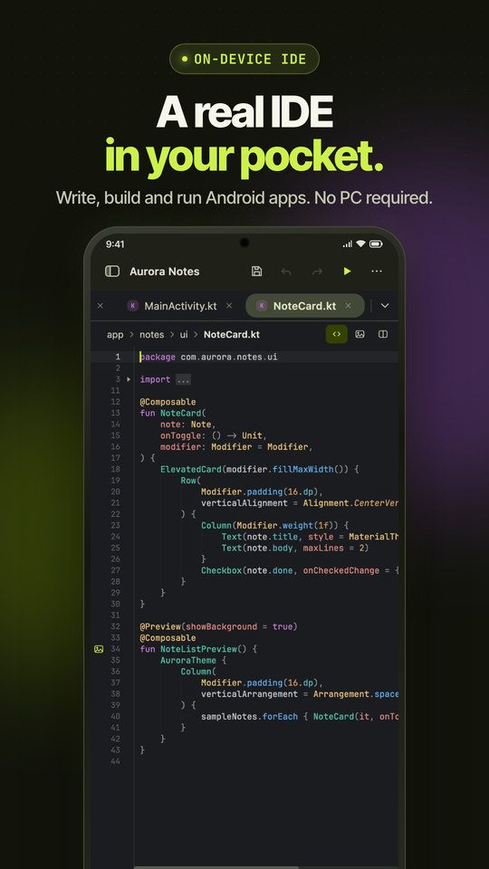
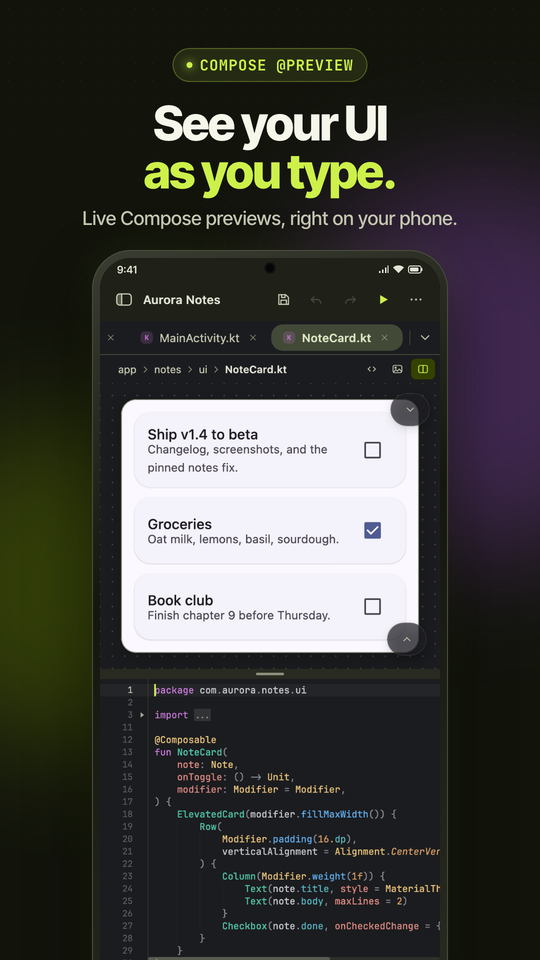
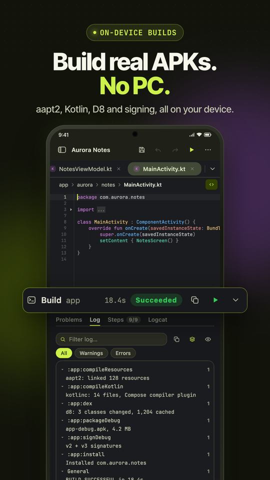

# CodeAssist

[](https://github.com/tyron12233/CodeAssist/actions)
[](https://github.com/tyron12233/CodeAssist/releases)
[](LICENSE)
[](https://discord.gg/y2gycT6pDW)

CodeAssist is an IDE for Android that runs on Android. You can write Kotlin and Java, preview Compose and
XML layouts, and build, sign and install APKs on the phone itself, without a computer or a remote build
server. A desktop version for Windows and Linux is built from the same code.

<p align="center">
  
  
  
</p>

## Features

- Kotlin and Java editing: completion, auto-import, errors as you type with quick fixes, go to
  definition/implementation, reformat and optimize imports.
- Android XML completion and validation for layouts, manifests and resource files.
- Compose `@Preview` functions render next to the code and update as you edit. XML layouts preview too,
  including your own custom views.
- Builds run on the device: aapt2, kotlinc, ecj, D8/R8 and apksigner. Builds are incremental. Output can
  be a debug APK, or a release APK or App Bundle signed with your own key.
- Multi-module projects, build variants, ViewBinding, AIDL, KSP (Room, Hilt) and Firebase's
  `google-services.json`.
- Dependencies from Maven Central, Google's Maven repository, and local JAR and AAR files.
- Import an existing Gradle project, or export a project as a Gradle project to open in Android Studio.
- Git: clone, commit, branch, merge, stash and push. With a GitHub sign-in you can clone private
  repositories and open pull requests.
- An optional AI coding agent that uses your own API key (Anthropic, Gemini, OpenAI or OpenRouter).
- Plugins can add languages, build steps, tool windows and project templates. C/C++ (NDK) support is a
  separate plugin.

## Limitations

- CodeAssist does not run Gradle. Build scripts are read when a project is imported (dependencies,
  version catalogs, the common `android {}` options), but Gradle plugins and custom build logic are not
  executed.
- Only the bundled Kotlin compiler plugins are available: Compose, kotlinx.serialization and Parcelize.
- Kotlin support is newer than Java support and has more rough edges.
- Large projects are slow to index and build on phones with little RAM.

If something you need is missing, open an issue. It helps to know what people are trying to build.

## Download

- [GitHub Releases](https://github.com/tyron12233/CodeAssist/releases): the Android APK, and the desktop
  builds for Windows and Linux.
- [Google Play](https://play.google.com/store/apps/details?id=com.tyron.code)

The Play build and the GitHub APK are signed with different keys, so one can't be installed over the
other.

## How it works

Gradle is too heavy to run on a phone, so CodeAssist keeps its own project model. Each module's build is a
graph of tasks with up-to-date checks, much like Gradle's, and the tasks call the Android tools directly
instead of going through the Android Gradle Plugin. Changing one file only re-runs the tasks that depend
on it.

Java analysis uses Eclipse JDT. Kotlin uses the Kotlin compiler's parser with CodeAssist's own analysis on
top, so completion doesn't have to start a full compiler session on every keystroke. Symbol indexes for
libraries and the Android SDK are stored on disk and read in place, which keeps memory use flat as
projects grow.

Compose previews don't install anything. The project's compiled code runs in a bytecode interpreter
inside the IDE, against the real Compose runtime.

More detail is in [docs/architecture.md](docs/architecture.md), and the full list of documents is in
[docs/README.md](docs/README.md).

## Building from source

You need JDK 17 or newer (CI uses JDK 25). The Android SDK is only needed for the full build.

```sh
# Core modules only: plain JVM, no Android SDK needed
CI_CORE_ONLY=true ./gradlew check

# Everything, including the Compose UI and the Android app
./gradlew build

# Run the desktop IDE
./gradlew :ide-desktop:run

# Build the Android app
./gradlew :ide-android:assembleDebug
```

## Project layout

```
platform/      core services with no IDE-specific knowledge; everything depends on it
lang/          the language SPI, indexes, analysis, and the Java/Kotlin/XML backends
build-system/  the incremental task engine and the JVM build pipelines
run/           running project code on device: interpreter, bytecode VM, AWT/Swing
android/       Android support: facets, variants, SDK data, layout preview
services/      dependencies, version control, the project store, analytics, the AI agent
plugins/       the plugin SPI and the host that loads plugins
app/           the Compose UI and the Android, desktop and command-line launchers
tools/         test harnesses
```

Gradle project paths are flat (`:lang-kotlin` lives in `lang/lang-kotlin`); `settings.gradle.kts` maps
them. [docs/modules.md](docs/modules.md) describes each module.

## Tests and benchmarks

Completion quality, editor latency, indexing and build performance are checked against committed
baselines by the `regressionTest` tasks. The numbers below are regenerated on each release.

<!-- AUTOGEN:benchmarks:START -->
| Area | Metric | Result |
|---|---|---|
| Java completion **quality** | recall / top-1 / MRR | **100%** / 75% / 0.88 |
| Java completion **latency** (per keystroke) | member access / type ref | **4.3 ms** / 2.8 ms |
| Symbol **index** quality | recall / top-1 / MRR | **100%** / 90% / 0.95 |
| Symbol **index** query | prefix / fuzzy | ~4.4 µs / ~56 ns |
<!-- AUTOGEN:benchmarks:END -->

Recall is how often the expected item appears in the completion list at all, top-1 how often it is
first, and MRR the average of 1/rank. Latency is measured on the maintainer's machine, so treat it as a
rough figure.

<!-- AUTOGEN:tests:START -->
**2252** tests passing across **406** suites · 0 failing · 2 skipped (framework / `CI_CORE_ONLY`).
<!-- AUTOGEN:tests:END -->

## Contributing

Bug reports and pull requests are welcome. For anything larger than a small fix, open an issue first so
we can agree on the approach. Before sending a pull request, run `CI_CORE_ONLY=true ./gradlew check`; it
is what CI runs.

Plugin authors should start with [docs/writing-plugins.md](docs/writing-plugins.md).

For questions and discussion, join the [Discord server](https://discord.gg/y2gycT6pDW).

## License

CodeAssist is licensed under the GNU General Public License v3.0 or later. See [LICENSE](LICENSE).

The plugin SPI modules (`plugin-api`, `plugin-ui-api`, `platform-core`, `vfs-api`, `project-model-api`,
`language-api`, `index-api`, `analysis-api` and `build-api`, published under `io.github.tyron12233`) also
carry the Classpath exception (see [LICENSE-EXCEPTION](LICENSE-EXCEPTION)), so a plugin compiled against
them can use any license.
